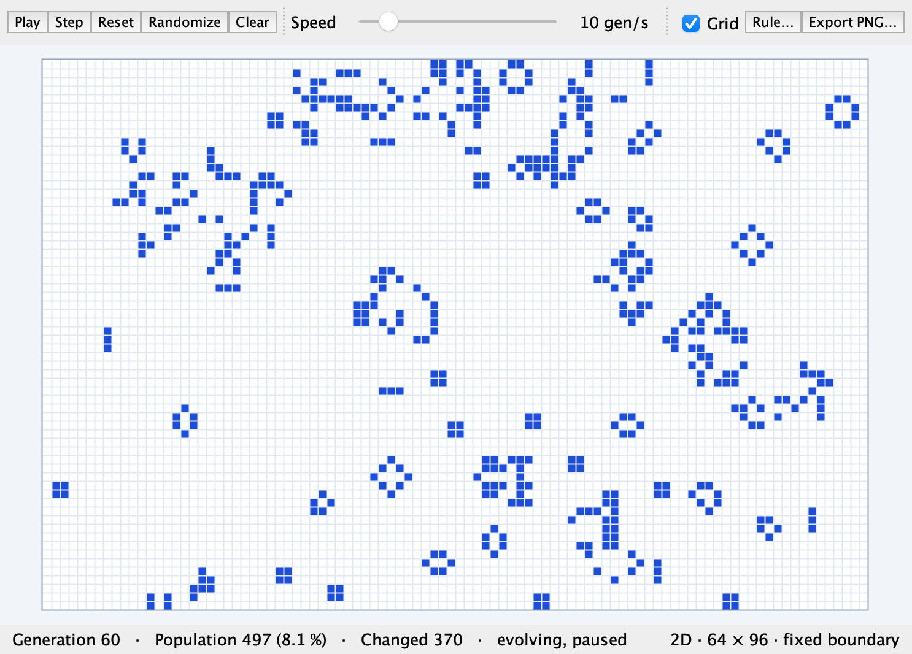
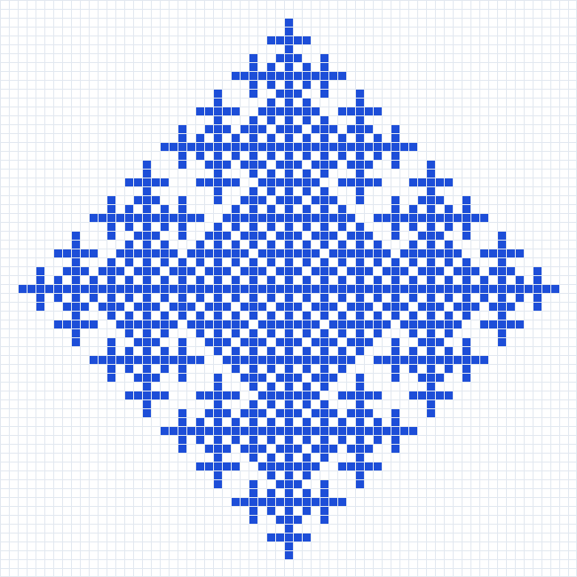
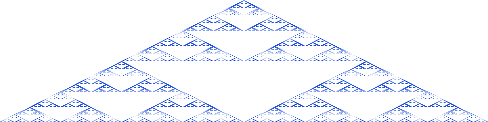

<h1 align="center">Cellula</h1>

<p align="center">
  A cellular automaton engine for grids of <em>any</em> dimension,<br>
  with its own rule language, XML definitions and a Swing viewer.
</p>

<p align="center">
  
  
  
  
</p>

<p align="center">
  
</p>

Cellula simulates any cellular automaton you can describe in a small text file: the dimension and
size of the grid, the rule that makes cells change state, and the initial state. One, two, three
or seven dimensions make no difference to the engine; the grid is a recursive structure whose
dimension is only known at run time.

It was written for the object-oriented programming course of Sup Galilée (INFO 1, 2023–2024). The
[subject](docs/assignment/SUJET.md) is in French; everything else here is in English.

## Highlights

- **Any dimension.** The same code runs a line, a plane, a cube or a 4D hypercube. Grids of three
  dimensions or more are shown through a plane you can move while the simulation runs.
- **A rule language.** Rules are written with the operators of the subject
  (`SI`, `ET`, `OU`, `NON`, `EQ`, `SUP`, `SUPEQ`, `ADD`, `SUB`, `MUL`, `COMPTER`) and parsed into a
  syntax tree. Mistakes are reported with the line, the column and a caret under the culprit.
- **Neighborhoods.** `G0`, `G2`, `G4`, `G8`, `G6`, `G26` and their starred variants are built in,
  generated for every dimension from two formulas, and you can declare your own.
- **Validated input.** Definition files are checked against an XML Schema, then for consistency,
  then by compiling their rule. A broken file is explained, never silently ignored.
- **A responsive viewer.** The simulation runs on its own thread and hands immutable snapshots to
  the window: play, pause, step, change speed, draw cells with the mouse, export PNG images.
- **Batch mode.** Every feature is also a command (`print`, `render`, `validate`, ...), so
  automata can be run and pictured on a machine without a display.
- **Bonus: a rule explorer.** `cellula explore` searches the 2<sup>32</sup> one-dimensional rules
  of radius 2 for fractal and chaotic ones, and writes its finds as ordinary definition files.
- **No runtime dependency.** Only the JDK. 409 tests, 97% line coverage outside the Swing classes.

## Quick start

You need a JDK, version 21 or newer. Maven is not required: the wrapper downloads it.

```bash
./mvnw package
```

```bash
java -jar target/cellula.jar --dir examples
```

The menu lists the definition files of the directory. Pick one and press **Run simulation**.

| In the simulation window | |
| --- | --- |
| <kbd>Space</kbd> | play / pause |
| <kbd>→</kbd> | advance by one generation |
| <kbd>R</kbd> | go back to generation 0 |
| click or drag on the grid | switch cells on and off |
| slice spinners (3D and more) | move the displayed plane |

No network to download Maven? The application only needs the JDK, so it can be built by hand:

```bash
javac -d out $(find src/main/java -name '*.java') && cp -R src/main/resources/. out/
```

```bash
java -cp out fr.uspn.cellula.Main --dir examples
```

## Describing an automaton

A definition is an XML file whose root element is `<automaton>`. This is the Game of Life, as
shipped in [`examples/game-of-life.xml`](examples/game-of-life.xml):

```xml
<automaton name="Game of Life">
  <description>Conway's Game of Life on a random soup.</description>
  <dimension>2</dimension>
  <size>64, 96</size>
  <rule>
    SI(EQ(COMPTER(G0), 1),
       OU(EQ(COMPTER(G8*), 2), EQ(COMPTER(G8*), 3)),
       EQ(COMPTER(G8*), 3))
  </rule>
  <initial>RANDOM(15)</initial>
</automaton>
```

Read it as: *if the cell is alive, it stays alive with two or three live neighbors; otherwise it
is born with exactly three.* `G8*` is the 8-neighborhood without the cell itself, and
`RANDOM(15)` switches each cell on with a probability of 15%.

A grid of three dimensions or more also says which plane to display, in the Matlab-like notation
of the subject, and any file may declare its own neighborhoods:

```xml
<slice>(32, :, :)</slice>
<neighborhoods>
  <neighborhood name="G3">{(0, 0, 0), (1, 1, 0), (-1, 0, 0)}</neighborhood>
</neighborhoods>
```

The full reference is in [docs/definition-format.md](docs/definition-format.md) and
[docs/rule-language.md](docs/rule-language.md).

## Examples

| File | What it shows |
| --- | --- |
| [`game-of-life.xml`](examples/game-of-life.xml) | Conway's Game of Life from `RANDOM(15)` — required by the subject |
| [`sierpinski.xml`](examples/sierpinski.xml) | Rule 18 drawing the Sierpiński triangle — required by the subject |
| [`growth.xml`](examples/growth.xml) | The predictable automaton of figures 1 and 2 of the subject |
| [`subject-example.xml`](examples/subject-example.xml) | The rule decomposed in section 2.3 of the subject, verbatim |
| [`glider.xml`](examples/glider.xml) | Explicit initial cells, periodic boundary, cycle detection |
| [`rule-30.xml`](examples/rule-30.xml), [`rule-110.xml`](examples/rule-110.xml) | Chaotic and Turing-complete rules, using user-defined neighborhoods |
| [`brians-brain.xml`](examples/brians-brain.xml) | Three states, custom colors, the `ETAT()` extension |
| [`snowflake.xml`](examples/snowflake.xml) | A hexagonal lattice obtained with a user-defined neighborhood |
| [`crystal-3d.xml`](examples/crystal-3d.xml), [`clouds-3d.xml`](examples/clouds-3d.xml) | Three dimensions, `G6*` and `G26*`, a movable slice |
| [`hypercube-4d.xml`](examples/hypercube-4d.xml) | Four dimensions, where `G8` means something else |
| [`radius2-fractal.xml`](examples/radius2-fractal.xml), [`radius2-chaotic.xml`](examples/radius2-chaotic.xml) | The answers to the bonus question, found by `cellula explore` |

<p align="center">
  
  
</p>
<p align="center">
  
</p>

## Command line

```text
Usage: cellula [command] [options]

  menu       List the automaton files of a directory and launch one (default)
  run        Open the simulation window of one file
  list       Print the automaton files of a directory
  validate   Check definition files
  print      Run an automaton and print the result as text
  render     Run an automaton and save the result as a PNG image
  explore    Search radius-2 one-dimensional rules for fractal or chaotic ones
  help       Show this help, or the help of a command
  version    Print the version
```

Here `cellula` stands for `java -jar target/cellula.jar`. A few things to try:

```bash
java -jar target/cellula.jar print examples/sierpinski.xml --steps 31
```

```bash
java -jar target/cellula.jar render examples/crystal-3d.xml --steps 30 --output crystal.png
```

```bash
java -jar target/cellula.jar validate examples/*.xml
```

```bash
java -jar target/cellula.jar explore --family symmetric --samples 50000 --write found
```

When a definition is wrong, you are told where and why:

```text
$ cellula validate life.xml
FAIL  life.xml
life.xml: unknown neighborhood 'G9' for a 2-dimensional grid (available: G0, G4, G4*, G8, G8*) (line 2, column 12)
       COMPTER(G9),
               ^
```

## Documentation

| | |
| --- | --- |
| [User guide](docs/user-guide.md) | The menu, the simulation window, the commands |
| [Definition format](docs/definition-format.md) | Every element of a definition file |
| [Rule language](docs/rule-language.md) | Grammar, operators, neighborhoods, worked examples |
| [Architecture](docs/architecture.md) | Packages, design decisions, threading model |
| [Bonus question](docs/bonus.md) | How the fractal and chaotic radius-2 rules were found |
| [Subject](docs/assignment/SUJET.md) | The assignment, in French ([original PDF](docs/assignment/sujet.pdf)) |
| [Report](report/report.pdf) | The project report, with class diagrams ([LaTeX sources](report)) |

## Project layout

```text
src/main/java/fr/uspn/cellula
├── grid/           DynamicArrayND, Grid, Cell, boundary conditions, slices
├── neighborhood/   Neighborhood as an Iterable walk; predefined and user-defined ones
├── rule/           Rule; expression/ (the operator hierarchy); parser/ (lexer, parser)
├── automaton/      CellularAutomaton: grid + rule + clock, convergence and cycle detection
├── config/         AutomatonDefinition, XML reader and writer, definition library
├── simulation/     Simulation (threading) and projections (plane, space-time)
├── render/         Palette, PNG and text renderers
├── ui/             swing/ (menu and simulation windows), text/ (terminal menu)
├── explore/        Rule explorer for the bonus question
└── cli/            Command-line interface
examples/           Definition files
docs/               Guides, reference, pictures, the subject
report/             LaTeX sources and PDF of the report
```

Dependencies point one way: `ui` and `cli` → `simulation` → `config` → `automaton` → `rule` →
`neighborhood` → `grid`. The model knows nothing about files, threads or pixels.

## Development

```bash
./mvnw verify
```

compiles with every lint as an error, runs the tests and writes the coverage report to
`target/site/jacoco/index.html`. The suite never opens a window; on a workstation,
`./mvnw verify -Dtest.headless=false` also runs the Swing tests against the real (hidden) windows.

See [CONTRIBUTING.md](CONTRIBUTING.md) for the conventions and for recipes such as adding an
operator to the rule language, and [CHANGELOG.md](CHANGELOG.md) for the history.

## License

[MIT](LICENSE) © 2024 Dmytro Palahin
