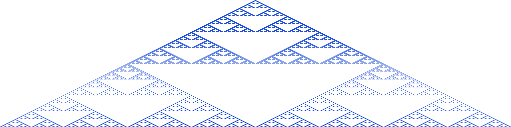
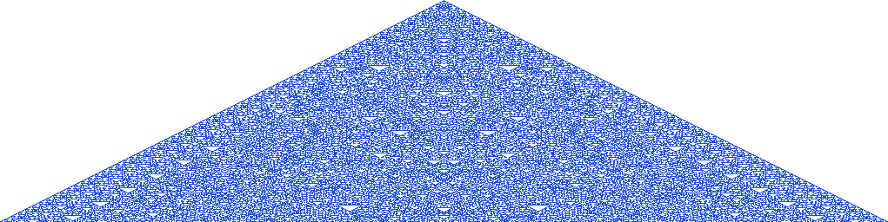

# Bonus question: a fractal or chaotic rule of radius 2

> Find a one-dimensional cellular automaton whose successive states, once juxtaposed, draw a
> fractal or chaotic figure. Its rule must consider the two cells to the left of the current cell
> and the two cells to its right, and the figure must not be obtainable with the left, current
> and right cells alone. Beware: there are about 2^(2^5) such rules.

Two answers were found with the program itself, and both ship as ordinary definition files.

| | Fractal | Chaotic |
| --- | --- | --- |
| File | [`examples/radius2-fractal.xml`](../examples/radius2-fractal.xml) | [`examples/radius2-chaotic.xml`](../examples/radius2-chaotic.xml) |
| Rule, in words | a cell is on when **exactly one** of the five cells is on | a cell is on when **one, two or four** of the five cells are on |
| Rule, in the rule language | `EQ(COMPTER(G4), 1)` | `OU(EQ(COMPTER(G4), 1), OU(EQ(COMPTER(G4), 2), EQ(COMPTER(G4), 4)))` |
| Wolfram code (32-bit truth table) | 65814 | 1771542398 |
| Totalistic code | 2 | 22 |
| Box-counting dimension | 1.50 | 1.95 |
| Compression ratio | 0.03 | 0.43 |

where `G4 = {(-2), (-1), (0), (1), (2)}` is declared in the files: the cell, its two left and its
two right neighbors.





Both pictures show generations 0 to 255, top to bottom, from a single live cell.

## How they were found

```bash
java -jar target/cellula.jar explore --write examples
```

### 1. A fast simulator for a narrow problem

The general engine evaluates a syntax tree for every cell: perfect for running *one* automaton of
any dimension, too slow for trying thousands of them. A two-state, one-dimensional rule of radius
2 is entirely described by its truth table: 2⁵ = 32 neighborhoods, one output bit each, hence a
32-bit number and 2³² rules. [`TableRule`](../src/main/java/fr/uspn/cellula/explore/TableRule.java)
stores that number and computes a generation with one table lookup per cell, sliding a 5-bit
window along the row.

### 2. Families instead of 2³² rules

Enumerating four billion rules is out of reach, so
[`RuleExplorer`](../src/main/java/fr/uspn/cellula/explore/RuleExplorer.java) explores families:

| Family | Size | How |
| --- | --- | --- |
| `totalistic` | 64 | The next state only depends on *how many* of the five cells are on. Explored exhaustively. |
| `symmetric` | 2²⁰ | The rule is unchanged by swapping left and right. Sampled at random. |
| `general` | 2³² | All rules. Sampled at random. |

Rules that switch cells on in an empty row are skipped: their whole background flickers and there
is no picture to speak of.

### 3. Measuring a picture

Each rule is run for 255 generations from a single live cell, on a row wide enough for the
pattern never to reach the edges. The resulting 256-row picture is measured in two ways
([`SpaceTimeDiagram`](../src/main/java/fr/uspn/cellula/explore/SpaceTimeDiagram.java)).

**Box-counting dimension.** Cover the picture with boxes of side *s* and count the boxes
containing a live cell, *N(s)*. For a fractal, *N(s)* grows like *s*<sup>−D</sup> as the boxes
shrink. *D* is the slope of the least-squares line through the points (log 1/*s*, log *N(s)*) for
*s* = 2, 4, 8, 16, 32. A line has dimension 1, a filled triangle 2, and the Sierpiński triangle
log 3 / log 2 ≈ 1.585 — which is the value the program measures for rule 18, to three decimals.

**Compression ratio.** Pack the cells eight to a byte, deflate, and divide the compressed size by
the packed size. Uniform and periodic pictures compress to almost nothing, nested ones compress
well, and disordered ones resist.

The two numbers place a picture in one of four classes:

| Verdict | Criterion |
| --- | --- |
| extinct | the last row is empty |
| regular | compression below 0.015, or dimension below 1.25, or a filled area that compresses well |
| **fractal** | dimension between 1.25 and 1.85 |
| **chaotic** | dimension above 1.85 and compression above 0.30 |

The thresholds were calibrated on elementary rules whose behavior is well known:

| Radius-1 rule | Dimension | Compression | Verdict |
| --- | :---: | :---: | --- |
| 4 (a lone cell persists) | 1.000 | 0.005 | regular |
| 254 (filled triangle) | 1.962 | 0.057 | regular |
| 18, 90 (Sierpiński) | 1.585 | 0.061 | fractal |
| 150 | 1.695 | 0.081 | fractal |
| 30 | 1.944 | 0.386 | chaotic |
| 45 | 1.988 | 0.587 | chaotic |

This classification is a filter, not a proof: it shortlists candidates, and the final choice is
made by looking at the pictures.

### 4. Making sure radius 2 is really needed

The question excludes figures that the left/center/right neighborhood can produce. A candidate is
kept only if it passes two tests:

1. its truth table depends on at least one of the two outer cells
   (`TableRule.fitsRadius(1)` is false);
2. its picture differs from the picture of **each of the 256 rules of radius 1** run from the
   same row (`RuleExplorer.reproducibleWithRadiusOne`).

For the two rules above there is also a one-line argument: their pattern widens by two cells per
generation on each side, while a rule of radius 1 can propagate information by at most one cell
per generation.

### 5. Back to the general engine

A rule worth keeping is translated into the rule language (`TableRule.toExpression`): a
totalistic rule becomes tests on `COMPTER` over the five cells, any other rule a decision tree of
`SI` operators over one-cell neighborhoods. The result is written as a definition file
(`XmlDefinitionWriter`) and is from then on an automaton like any other, run by the general
engine.

A test runs the two implementations side by side, on the six classic radius-1 rules and on random
radius-2 rules, and checks that they agree on every cell of every generation
([`TableRuleTest`](../src/test/java/fr/uspn/cellula/explore/TableRuleTest.java)). The fast
simulator and the translation thereby validate each other.

## Results

On the 64 totalistic rules the search takes about a second and reports 7 fractal and 6 chaotic
rules that genuinely need radius 2:

```text
Fractal pictures, by increasing box-counting dimension
  rule code    totalistic  dimension  compression
  65814        code 2      1.502      0.032
  2147549462   code 34     1.532      0.033
  18290558     code 6      1.534      0.053
  394231806    code 14     1.572      0.054
  2147483646   code 30     1.590      0.055

Chaotic pictures, by decreasing compression ratio
  rule code    totalistic  dimension  compression
  1771542398   code 22     1.945      0.430
  1753317654   code 18     1.904      0.411
  2129258902   code 26     1.932      0.364
  3900801302   code 50     1.893      0.363
  2541715454   code 46     1.955      0.347
```

Among them is totalistic code 42, the parity of the five cells, which generalizes the Sierpiński
rule (the parity of the two outer cells).

Sampling 20 000 rules of the `symmetric` or of the `general` family takes about 8 seconds on the
laptop used for development and shortlists a few thousand candidates each; the searches are reproducible thanks
to `--seed`.
