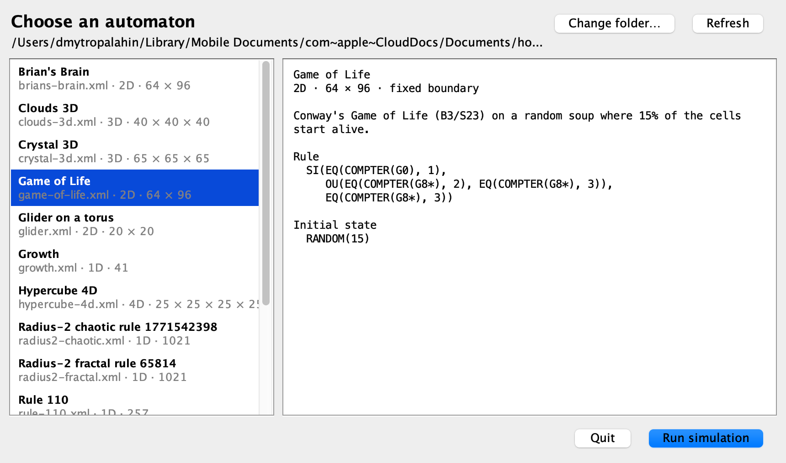
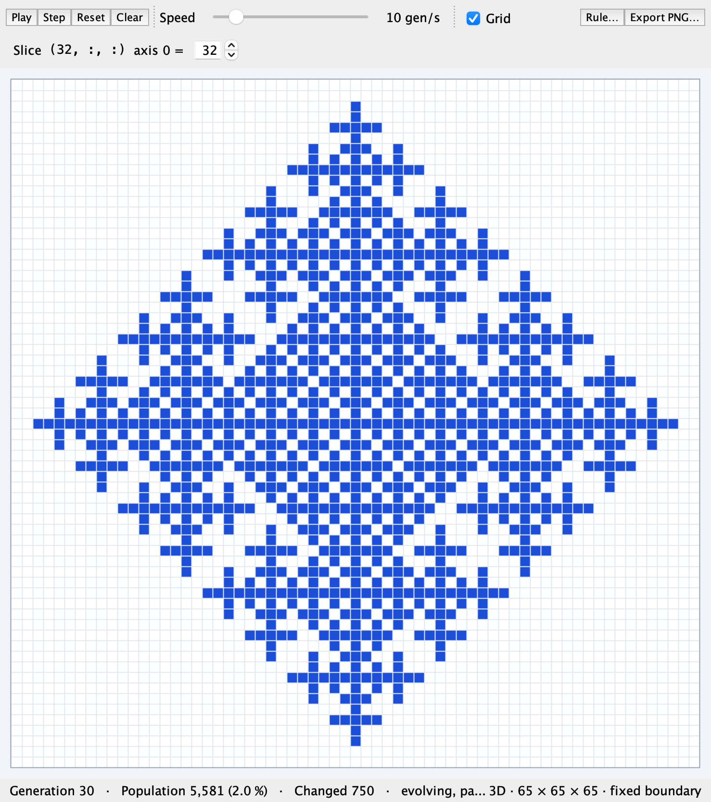

# User guide

- [Installing](#installing)
- [The menu](#the-menu)
- [The simulation window](#the-simulation-window)
- [Commands](#commands)
- [Troubleshooting](#troubleshooting)

Throughout this guide, `cellula` stands for `java -jar target/cellula.jar`.

## Installing

Cellula needs a JDK, version 21 or newer, and nothing else.

```bash
./mvnw package
```

builds `target/cellula.jar`. On Windows use `mvnw.cmd package`. The jar is self-contained: it can
be copied anywhere and started with `java -jar`.

## The menu

```bash
java -jar target/cellula.jar --dir examples
```

Started without a command, Cellula shows the menu of the automaton definition files found in a
directory: the current directory, or the one given with `--dir`.

<p align="center"></p>

- Select a file to see what it describes; double-click it, or press **Run simulation**, to start
  it. Several simulations can be open at once.
- **Change folder…** lists another directory, **Refresh** re-reads the current one after you
  edited a file.
- A file that looks like a definition but is invalid is listed in red. Selecting it shows what is
  wrong, with the line and column for errors in the rule.

On a machine without a display, or with `--text`, the menu is shown in the terminal instead:

```text
Automaton definitions in /home/me/cellula/examples

  [1] game-of-life.xml             Game of Life               2D  64 × 96
  [2] sierpinski.xml               Sierpiński triangle        1D  257

Number of the automaton to run, [r] rescan, [q] quit >
```

## The simulation window

<p align="center"></p>

### Controls

| Control | Key | Effect |
| --- | --- | --- |
| **Play** / **Pause** | <kbd>Space</kbd> | Start or stop the automatic advance |
| **Step** | <kbd>→</kbd> | Advance by exactly one generation |
| **Reset** | <kbd>R</kbd> | Go back to generation 0, exactly as it was |
| **Randomize** | | Draw a new random initial state (only for `RANDOM(k)` definitions) |
| **Clear** | | Switch every cell off, to draw a pattern by hand |
| **Speed** | | Generations per second, from 1 to 60, or as fast as possible |
| **Grid** | | Show or hide the lines between cells |
| **Rule…** | | Show the definition: rule, neighborhoods, initial state |
| **Export PNG…** | | Save the current picture |

### Drawing

Click a cell to toggle it; keep the button down and drag to paint. Drawing works while the
simulation is running or paused. What you draw at generation 0 becomes the state that **Reset**
goes back to.

### What is displayed

| Grid | Display |
| --- | --- |
| 1 dimension | The juxtaposition of the successive generations: time runs down the window, and the picture scrolls once it is full. Clicking any row edits the current generation. |
| 2 dimensions | The grid at the current generation. |
| 3 dimensions and more | One plane of the grid at the current generation. The **Slice** bar shows which, and has one spinner per pinned axis to move the plane while the simulation runs. |

### Status bar

```text
Generation 127  ·  Population 128 (49.8 %)  ·  Changed 192  ·  evolving, paused
```

- **Population** counts the cells of the whole grid that are not off, not just those on screen.
- **Changed** is the number of cells modified by the last step.
- The last field tells what the automaton has been observed to do:
  - `evolving` — nothing special so far;
  - `converged` — the last step changed nothing, so nothing will ever change again; the
    simulation pauses by itself;
  - `cycle of period N` — the grid is back in a configuration it was in N generations ago, so it
    will repeat forever. Cycles of up to 1024 generations are detected.

## Commands

Run `cellula help` for the list and `cellula help <command>` for the options of one.

### `menu` — the default

```text
cellula [menu] [--dir DIR] [--text]
```

### `run` — skip the menu

```text
cellula run FILE
```

### `list` and `validate` — inspect files

```text
cellula list [--dir DIR]
cellula validate FILE...
```

`validate` exits with status 1 if a file is invalid, so it can guard a commit or a build.

### `print` and `render` — run without a window

```text
cellula print FILE [--steps N] [--ascii]
cellula render FILE --output IMAGE.png [--steps N] [--cell-size PX] [--no-grid]
```

Both run the automaton for N generations (32 by default) and output what the window would show:
`print` as text on standard output, `render` as a PNG image.

```text
$ cellula print examples/growth.xml --steps 4 --ascii
Growth (1D · 41 · fixed boundary)
Generations 0 to 4, one per line:
....................#....................
...................###...................
..................#####..................
.................#######.................
................#########................
```

### `explore` — the bonus question

```text
cellula explore [--family totalistic|symmetric|general] [--samples N] [--seed S]
                [--steps T] [--top K] [--write DIR]
```

See [bonus.md](bonus.md).

### Exit statuses

| Status | Meaning |
| :---: | --- |
| 0 | Success |
| 1 | The command could not do its job: invalid definition, unreadable file |
| 2 | The command line itself is wrong: unknown command or option, missing argument |

## Troubleshooting

**"no display available"** — `run` needs a screen. On a server, use `print` or `render`.

**A file does not appear in the menu.** Only `*.xml` files whose root element is `<automaton>`
are listed, and only those directly in the directory. Check the spelling of the root element.

**The simulation is slow.** The cost of a generation is the number of cells times the size of the
neighborhoods the rule explores. A 65 × 65 × 65 grid with `G26` is 7 million cell reads per
generation. Reduce the grid, or use a smaller neighborhood. Large grids are computed on all the
processor cores automatically.

**"a grid of ... cells is too large"** — grids are limited to 64 million cells.
